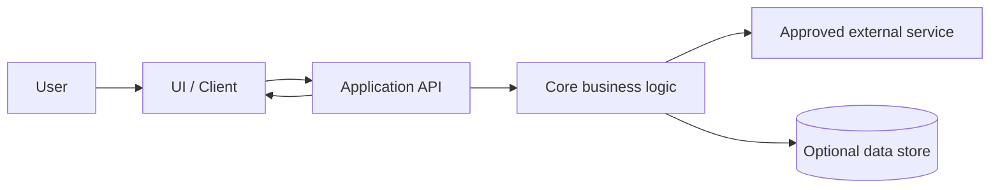

# Architecture Notes

## Context and system boundary
Describe the user, the application, external services, and trust boundaries.

## Proposed MVP architecture

Replace this diagram with the actual design. Remove components that are not needed.

## Component responsibilities
| Component | Responsibility | Public interface | Owner |
|---|---|---|---|
| UI / client | | | |
| API / controller | | | |
| Core logic | | | |
| AI adapter (if needed) | | | |
| Persistence (if needed) | | | |

## Design principles
- Keep UI, business logic, AI/provider integration, and persistence separated where useful.
- Use SOLID principles pragmatically; avoid speculative abstractions.
- Hide provider-specific details behind a small adapter if provider replacement is plausible.
- Define timeouts, input limits, and failure behavior for external calls.
- Keep secrets server-side and validate untrusted input.
- Add caching, queues, vector stores, or agent orchestration only when justified by an acceptance criterion.

## Key trade-offs
| Decision | Options considered | Chosen option | Why | Revisit when |
|---|---|---|---|---|
| | | | | |

## Future extension points (not MVP commitments)
- Cache: interface, TTL, invalidation strategy.
- Retrieval/RAG: ingestion, chunking, metadata, retrieval, citations, evaluation.
- LLM: provider adapter, model choice, timeout/retry, token budget.
- Observability: structured logs, latency, usage, failure rates.
- Security: authorization, rate limits, secret management, data retention.
- Scalability: load profile, queues, concurrency, database indexes.
